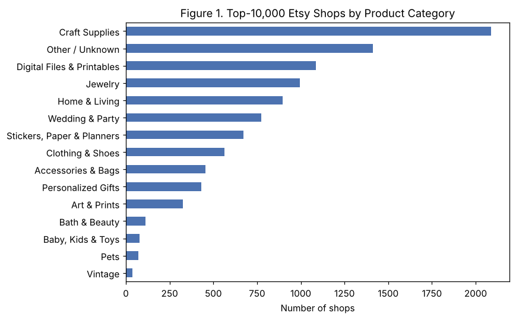
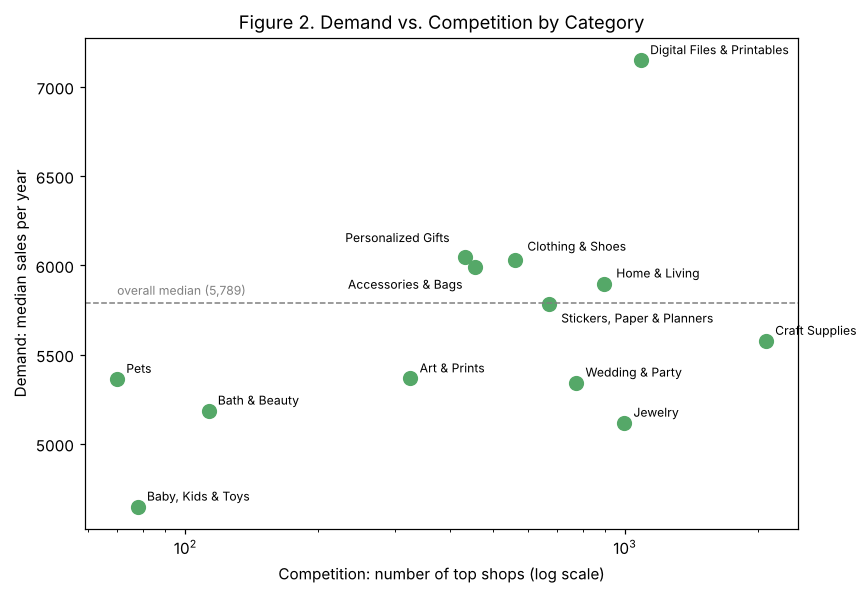
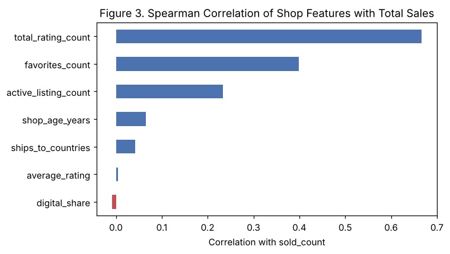
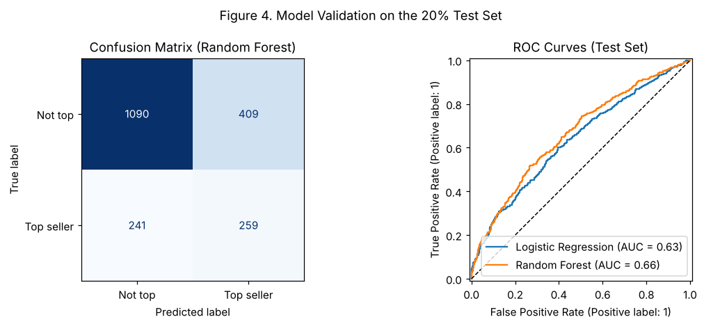
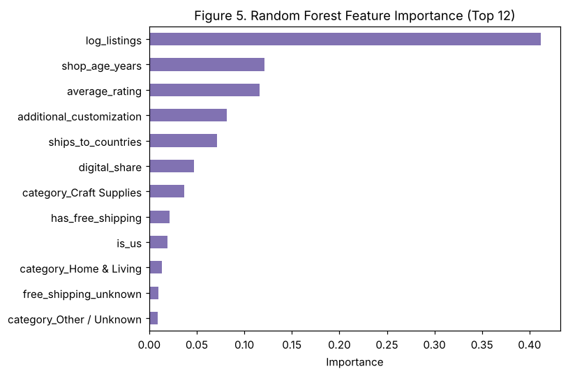

# Finding a Profitable Product for a New Etsy Shop

## Overview

Etsy has about 5.6 million active sellers, and most new sellers choose what to sell based on what they like to make, not on data. This project works backward from success: using data on Etsy's **top 10,000 shops**, it looks at which product categories have strong demand compared to how crowded they are, which shop features go along with higher sales, and whether a model can predict top sellers from features a seller controls.

## Research Questions

1. Which product categories have the strongest demand compared to how crowded they are?
2. Which shop features (listings, customization, free shipping, rating, shop age) are related to higher sales?
3. Can a model predict whether a shop is a top seller (top 25% of sales) using only features a seller can control?

## Key Results

- **Best balance:** Personalized Gifts, Accessories & Bags, and Clothing & Shoes have above-median demand (about 6,000 sales per year per shop) with moderate competition.
- **Most crowded:** Craft Supplies (2,089 top shops) and Jewelry have the most competition and below-median demand.
- **Highest demand:** Digital Files & Printables (7,149 sales per year) but over 1,000 competing top shops.
- **What top sellers have in common:** more listings (median 665 vs. 370), and they more often offer customization (58% vs. 45%) and free shipping (58% vs. 52%). Star rating barely matters, since 89% of shops are rated 4.8 or higher.
- **Sales are concentrated:** the top 25% of shops make 52% of all sales.

| Model | 5-fold CV ROC AUC | Test ROC AUC | Test balanced accuracy |
|-------|-------------------|--------------|------------------------|
| Logistic regression | 0.648 | 0.634 | 0.597 |
| Random forest | 0.666 | 0.662 | 0.623 |

**Takeaway:** shop features predict top sellers better than guessing, but only part of the way. Success on Etsy looks less like picking a lucky category and more like how you build your shop.

## Data

- **Source:** [1M+ Etsy Shops Sales Data](https://www.kaggle.com/datasets/polartech/1m-etsy-shops-sales-data) on Kaggle (third-party, not an official Etsy release)
- **File:** `data/etsy_04-03_Top10000_v2.csv`, 10,000 shops and 36 columns
- **Date range:** one snapshot collected April 3 to 5, 2022; sales are lifetime totals for shops opened 2010 to 2021
- **Verification:** consistency checks found no impossible values (no shops created after the collection date, no shops with more ratings than sales, no ratings outside 1 to 5)

## Approach

1. **Clean:** read with latin-1 encoding, checked for duplicates, removed seller names and URLs, dropped 7 shops with no rating (9,993 left)
2. **Label changes:** filled 1,446 missing free-shipping values as false and added a flag column
3. **Create features:** shop age, sales per year, digital share, number of shipping countries
4. **Categorize:** assigned 14 product categories using keywords in each shop's headline or name
5. **Compare categories:** demand (median sales per year) vs. competition (number of top shops), combined into an opportunity index
6. **Model:** logistic regression and random forest with balanced class weights, an 80/20 split, and 5-fold cross-validation. Favorites and ratings count were left out because they result from sales and would leak the answer.

## Visualizations

### Top shops by category


### Demand vs. competition


### Shop features and sales


### Model validation


### Feature importance


## Limitations

- Only top shops are included, so results describe successful shops, not what causes success.
- One snapshot from 2022; exact numbers have likely changed.
- Categories come from keywords, so some shops are in the wrong group (14% did not match).
- No prices, costs, or fees, so the analysis measures sales, not profit.

## How to Run

1. Clone this repository.
2. Install the packages: `pip install -r requirements.txt`
3. Open `notebooks/etsy_shop_analysis.ipynb` and run all cells. It finds the data in the `data/` folder and saves figures to `images/`.

## Repository Structure

```
etsy-shop-category-analysis/
├── README.md
├── requirements.txt
├── data/
│   └── etsy_04-03_Top10000_v2.csv
├── images/                # figures created by the notebook
├── notebooks/
│   └── etsy_shop_analysis.ipynb
└── reports/
    └── etsy_white_paper.pdf
```

## Tools

Python, pandas, NumPy, scikit-learn, Matplotlib
